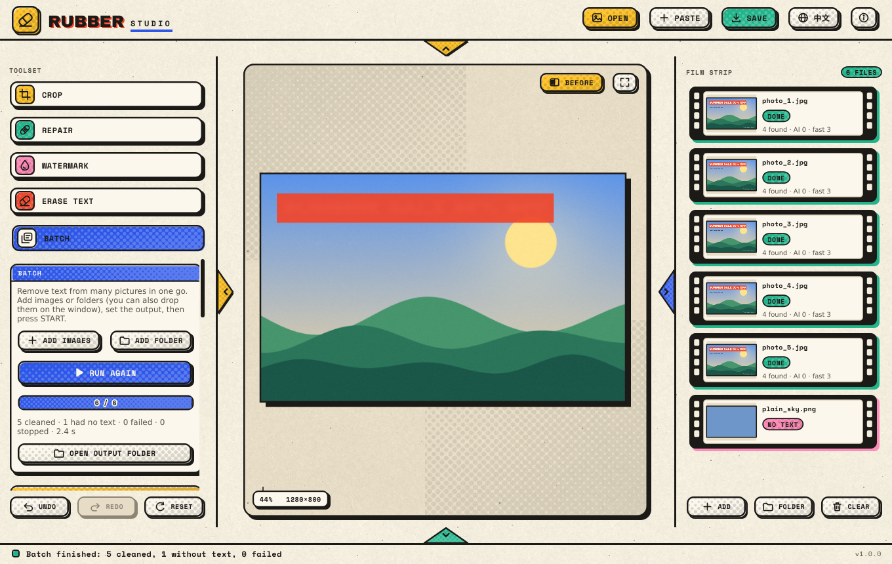

<div align="center">


# RUBBER STUDIO

**Erase · Repair · Restore**<br>
Batch-remove text from images — plus retouching, cropping and watermarking — fully offline, as a native Windows app.

<!--badges-->
[](https://github.com/03319053e-commits/RubberStudio/actions/workflows/build-windows.yml)
[](LICENSE)
<!--/badges-->

[**⬇ Download for Windows**](../../releases/latest) · [简体中文](README.zh-CN.md)



</div>

## What it does

- **Batch text removal** — drop a pile of pictures or whole folders onto the window, press *Start*, and every image comes
  back with its text gone. The queue is a *film strip* with live status for each frame; you can stop at any time,
  re-run, open any frame in the editor and compare before / after.
- **Real text removal, not blur** — an on-device detector (PP-OCRv4, Chinese + English + mixed text) finds the text, and
  only the *letter strokes* are repainted, so the picture around the text stays untouched. Flat and gradient
  backgrounds (banners, subtitles, captions, watermarks) are filled instantly; busy photo backgrounds can use an
  optional AI inpainting model (LaMa) that is downloaded once and then works offline.
- **Safe by default** — originals are never overwritten. Results go to a `RubberStudio_clean` folder next to each image
  (or any folder you pick), with a file-name suffix, output format (same / PNG / JPG / WebP) with quality, sub-folder
  structure kept, and a rule for existing files (rename / skip / overwrite). Several images are processed in parallel;
  images without text can be copied over too.
- **One region for all** — frame a spot on a sample picture (say a watermark strip in a corner) and clean exactly that
  relative area in every image.
- **Single-image tools** — *Erase text* (whole image or a framed region, with a detection preview and a before / after
  switch), *Repair* brushes (heal, smudge, re-grain texture), *Crop* and a text *Watermark* with font, colour, size and
  opacity.
- **Private** — nothing is uploaded. The only network access is the optional AI model download, and only after you
  confirm it.
- **Windows-ready** — portable folder (no installer, no admin rights), Unicode / Chinese paths everywhere, high-DPI
  aware, Chinese and English interface.

<div align="center">


</div>

## Download (Windows 10 / 11, 64-bit)

1. Open the [**latest release**](../../releases/latest) and download `RubberStudio-<version>-windows-x64.zip`.
2. Extract the zip anywhere (a normal folder, not from inside the zip viewer).
3. Run `RubberStudio.exe`.

The program is not code-signed, so Windows SmartScreen may say *"Windows protected your PC"* the first time:
click **More info → Run anyway**. Every release is built by the public [GitHub Actions workflow](.github/workflows/build-windows.yml)
from this repository, and the workflow runs the self-test of the built program before publishing it.

If the program does not start on a very fresh Windows install, install the
[Microsoft Visual C++ Redistributable (x64)](https://aka.ms/vs/17/release/vc_redist.x64.exe).

Settings, logs and the optional AI model live in `%LOCALAPPDATA%\RubberStudio`. Delete that folder to reset everything;
delete the program folder to uninstall.

## Using it

**Batch** — choose the *Batch* tool, then

1. add pictures or a folder (buttons, or drag them onto the window — several files or a folder go straight into the
   queue; a single file opens in the editor);
2. choose the output folder, format and options in the *Output* card;
3. press **Start**. Frames turn *Working → Done* (or *No text* / *Failed*); **Stop** cancels cleanly without writing
   half-finished files.

| Shortcut | Action |
|---|---|
| `Ctrl+O` / `Ctrl+S` | open / save |
| `Ctrl+C` / `Ctrl+V` | copy the picture / paste a picture from the clipboard |
| `Ctrl+Z` / `Ctrl+Y` | undo / redo |
| `Ctrl+Enter` / `Esc` | run the current tool / close it |
| `0`, wheel, `Space`+drag | fit to window, zoom, pan |
| `F1` | help |

The toolbars fold away like envelopes (click the tab on the edge) so the picture gets the whole window.

### AI fill (optional)

Open the *AI model* card in the *Erase text* tool: **Download** fetches `lama.onnx` (about 208 MB, Apache-2.0,
[Carve/LaMa-ONNX](https://huggingface.co/Carve/LaMa-ONNX)) from Hugging Face or a mirror after you confirm, or
**Import…** takes a model file you already have. Without it everything still works with the built-in fast fill.
Tick *Use AI model* to let complicated backgrounds use it automatically, or *Always use AI* to force it.

## Run from source

Python 3.10 or newer (CI uses 3.12) on Windows, Linux or macOS:

```bash
python -m venv .venv
.venv\Scripts\activate            # Linux/macOS: source .venv/bin/activate
pip install -r requirements.txt
python -m rubberstudio            # optional: python -m rubberstudio picture.png folder/
```

On Windows, `run_windows.bat` does the same in one double-click. Useful switches: `--lang en|zh`, `--no-splash`,
`--selftest report.json` (checks the bundled model, the engine, the batch runner and the GUI),
`--screenshot out.png --tool erase|batch|repair|crop|watermark` (renders the window headlessly).

## Build the Windows program yourself

Either let GitHub do it (push a tag such as `v1.0.0`; the workflow builds, tests and attaches the zip to a release), or
on a Windows machine with Python 3.12:

```bat
build_windows.bat
```

which creates a virtual environment, installs the dependencies and runs
`pyinstaller packaging\RubberStudio.spec`; the result is `dist\RubberStudio\RubberStudio.exe` and a ready-to-share zip.

Tests (engine and GUI, headless): `pip install -r requirements-dev.txt && python -m pytest`.

## How the text removal works

1. **Detect** — a DBNet text detector (PP-OCRv4, ONNX Runtime, CPU) finds text lines; big pictures are processed in
   overlapping tiles at native resolution so small print is not lost; tiny glyphs next to confident text ("©", bullets,
   dots) are recovered by hysteresis, and symbols the network does not react to at all are picked up by looking at the
   pixels right beside a line's ends (same ink colour, glyph-sized, on flat or smoothly shaded backgrounds only).
2. **Strokes only** — inside each box the background is modelled (a fitted plane on the box margin for flat or smooth
   surfaces, a local median otherwise) and the pixels that differ from it become the stroke mask, grown a little and
   closed so no speck of the glyph colour is left to be smeared by the fill.
3. **Fill** — flat surroundings get a fast inpainting fill with matched grain; busy ones go to LaMa when it is installed.

Tips: raise *Sensitivity* for faint or stylised text, lower it if non-text shapes get detected; raise *Stroke grow* if
a thin outline or shadow around the letters survives.

## Design

The interface speaks a colour-clash paper-and-film pop-art language: flat inks with deliberately mis-registered colour
fills, Ben-Day halftone dots on every coloured surface, hard offset shadows, buttons that press into them, paper grain,
Archivo Black + Space Mono type, and toolbars that fold like envelopes. All colours, fonts and metrics are centralised
in [`rubberstudio/theme.py`](rubberstudio/theme.py).

## Project layout

```
rubberstudio/
  core/        engine without Qt: text detector, stroke mask + fill, LaMa wrapper, batch runner, image I/O
  widgets/     canvas, drawer pages, film strip, envelope panels, pop-art controls, procedural icons, dialogs
  editor.py    editing model (tools, undo/redo, async erase)      mainwindow.py   window, drag & drop, shortcuts
  theme.py     design tokens and stylesheet                       strings.py      English / Chinese interface text
assets/        fonts (OFL), icon, UI images                       packaging/      PyInstaller spec and launcher
tests/         engine, batch and GUI tests                        .github/        Windows build workflow
```

## Responsible use

Use it on pictures you own or have permission to edit. Removing someone else's watermark, credit or licence notice
may infringe their rights.

## License

[MIT](LICENSE). Third-party components (detection model, fonts, Qt, OpenCV, ONNX Runtime, …) and their licenses are
listed in [NOTICE.md](NOTICE.md).
