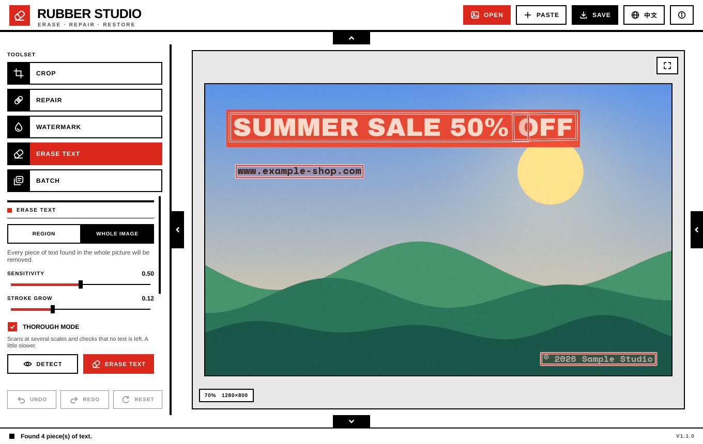
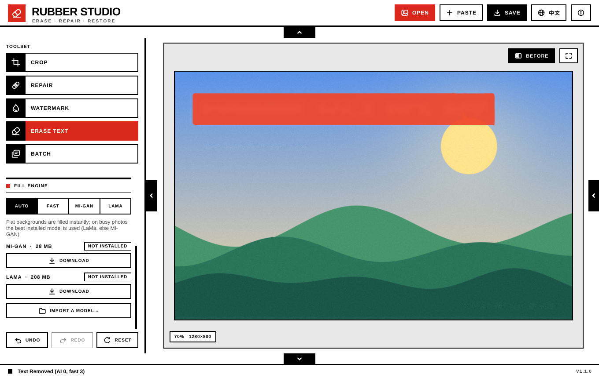
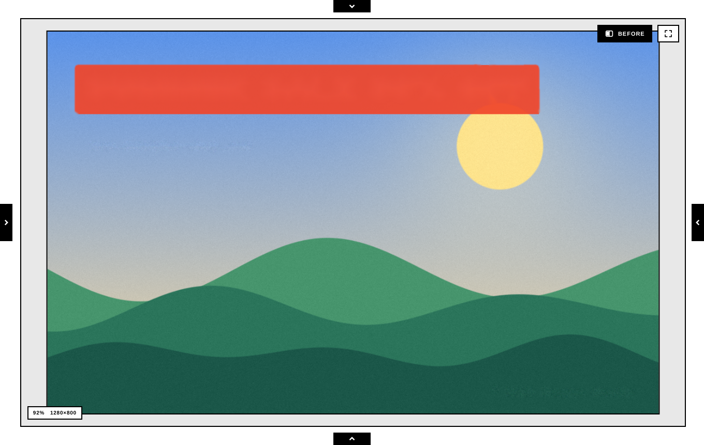

<div align="center">


# RUBBER STUDIO

**Erase · Repair · Restore**<br>
Batch-remove text from images — plus retouching, cropping and watermarking — fully offline, as a native Windows app.

<!--badges-->
[](https://github.com/03319053e-commits/RubberStudio/actions/workflows/build-windows.yml)
[](LICENSE)
<!--/badges-->

[**⬇ Download for Windows**](../../releases/latest) · [简体中文](README.zh-CN.md)


</div>

## What it does

- **Batch text removal** — drop a pile of pictures or whole folders onto the window, press *Start*, and every image comes
  back with its text gone. The queue shows live status for every picture; you can stop at any time, re-run, open any
  picture in the editor and compare before / after.
- **Real text removal, not blur** — two on-device detectors (PP-OCRv4 and PP-OCRv5, Chinese + English + mixed text, run at
  several scales) find the text, and only the *letter strokes* are repainted, so the picture around the text stays
  untouched. In *thorough mode* every stroke mask is checked by the detector itself — if text would still be visible it
  tries the next candidate — so thin, soft or letter-spaced type does not survive.
- **Choose the fill engine** — *Auto*, *Fast*, *MI-GAN* or *LaMa*. Flat and gradient backgrounds (banners, subtitles,
  captions, watermarks) are filled instantly by the built-in fill; patterned or photographic backgrounds use a neural
  model that is downloaded once (only after you confirm) and then works offline. See [Fill engines](#fill-engines).
- **Safe by default** — originals are never overwritten. Results go to a `RubberStudio_clean` folder next to each image
  (or any folder you pick), with a file-name suffix, output format (same / PNG / JPG / WebP) with quality, sub-folder
  structure kept, and a rule for existing files (rename / skip / overwrite). Several images are processed in parallel;
  images without text can be copied over too.
- **One region for all** — frame a spot on a sample picture (say a watermark strip in a corner) and clean exactly that
  relative area in every image.
- **Single-image tools** — *Erase text* (whole image or a framed region, with a detection preview and a before / after
  switch), *Repair* brushes (heal, smudge, re-grain texture), *Crop* and a text *Watermark* with font, colour, size and
  opacity.
- **Private** — nothing is uploaded. The only network access is the optional model download, and only after you
  confirm it.
- **Windows-ready** — portable folder (no installer, no admin rights), Unicode / Chinese paths everywhere, high-DPI
  aware, Chinese and English interface.

<div align="center">



</div>

## Download (Windows 10 / 11, 64-bit)

1. Open the [**latest release**](../../releases/latest) and download `RubberStudio-<version>-windows-x64.zip`.
2. Extract the zip anywhere (a normal folder, not from inside the zip viewer).
3. Run `RubberStudio.exe`.

The program is not code-signed, so Windows SmartScreen may say *"Windows protected your PC"* the first time:
click **More info → Run anyway**. Every release is built by the public [GitHub Actions workflow](.github/workflows/build-windows.yml)
from this repository, and the workflow runs the self-test of the built program before publishing it.

If the program does not start on a very fresh Windows install, install the
[Microsoft Visual C++ Redistributable (x64)](https://aka.ms/vs/17/release/vc_redist.x64.exe).

Settings, logs and the optional models live in `%LOCALAPPDATA%\RubberStudio`. Delete that folder to reset everything;
delete the program folder to uninstall.

## Using it

**Batch** — choose the *Batch* tool, then

1. add pictures or a folder (buttons, or drag them onto the window — several files or a folder go straight into the
   queue; a single file opens in the editor);
2. choose the output folder, format and options in the *Output* card;
3. press **Start**. Frames turn *Working → Done* (or *No text* / *Failed*); **Stop** cancels cleanly without writing
   half-finished files.

| Shortcut | Action |
|---|---|
| `Ctrl+O` / `Ctrl+S` | open / save |
| `Ctrl+C` / `Ctrl+V` | copy the picture / paste a picture from the clipboard |
| `Ctrl+Z` / `Ctrl+Y` | undo / redo |
| `Ctrl+Enter` / `Esc` | run the current tool / close it |
| `0`, wheel, `Space`+drag | fit to window, zoom, pan |
| `F1` | help |

The toolbars fold away (click the black tab on the edge) so the picture gets the whole window.

### Fill engines

The *Fill engine* card (in *Erase text* and *Batch*) decides how the gaps left by the text are filled:

| Engine | Download | Speed¹ | Best for |
|---|---|---|---|
| **Auto** (default) | – | 4–23 s | flat backgrounds use the built-in fill, busy ones the best installed model (LaMa, else MI-GAN) |
| **Fast** | none | ≈ 4 s | banners, captions, gradients, soft shading |
| **MI-GAN** | ≈ 28 MB | ≈ 7 s | photos and simple textures |
| **LaMa** | ≈ 208 MB | ≈ 23 s | complex patterns and textures (silk, fabric, foliage) |

¹ an 800 × 800 picture with two lines of text, 2 CPU cores, detection included.

**Download** fetches the model from Hugging Face (or a mirror) after you confirm — the files are checked against a pinned
SHA-256 — or **Import a model…** takes an ONNX file you already have. A model that is chosen but not installed is
replaced by the best one that is, and the status bar says so. Models are stored in `%LOCALAPPDATA%\RubberStudio\models`.

## Run from source

Python 3.10 or newer (CI uses 3.12) on Windows, Linux or macOS:

```bash
python -m venv .venv
.venv\Scripts\activate            # Linux/macOS: source .venv/bin/activate
pip install -r requirements.txt
python -m rubberstudio            # optional: python -m rubberstudio picture.png folder/
```

On Windows, `run_windows.bat` does the same in one double-click. Useful switches: `--lang en|zh`, `--no-splash`,
`--selftest report.json` (checks the bundled model, the engine, the batch runner and the GUI),
`--screenshot out.png --tool erase|batch|repair|crop|watermark` (renders the window headlessly).

## Build the Windows program yourself

Either let GitHub do it (push a tag such as `v1.1.0`; the workflow builds, tests and attaches the zip to a release), or
on a Windows machine with Python 3.12:

```bat
build_windows.bat
```

which creates a virtual environment, installs the dependencies and runs
`pyinstaller packaging\RubberStudio.spec`; the result is `dist\RubberStudio\RubberStudio.exe` and a ready-to-share zip.

Tests (engine and GUI, headless): `pip install -r requirements-dev.txt && python -m pytest`.

## How the text removal works

1. **Detect** — two DBNet text detectors (PP-OCRv4 and PP-OCRv5-mobile, ONNX Runtime, CPU) look at the picture at
   several scales and their boxes are merged line by line; big pictures are processed in overlapping tiles at native
   resolution so small print is not lost. Tiny glyphs next to confident text ("©", bullets, dots) are recovered by
   hysteresis, and symbols the network does not react to at all are picked up by looking at the pixels right beside a
   line's ends (same ink colour, glyph-sized, on flat or smoothly shaded backgrounds only).
2. **Strokes only** — inside each box several candidate ink colours are tried (colour-histogram peaks, the brightest and
   darkest pixels); each becomes a stroke mask, grown a little and closed so no speck of the glyph colour is left. The
   candidates are ranked by how clearly they separate the glyphs from their surroundings, and in *thorough mode* the
   first one that really works wins: the detector looks at the picture with that mask painted over, and only a mask after
   which no text is left is accepted (otherwise the whole padded box is used).
3. **Fill** — the gaps are filled in native-resolution 512 × 512 windows with plenty of context, blended with a feathered
   edge, and the picture's own sensor grain is put back so the repaired spot does not look airbrushed.

Tips: raise *Sensitivity* for faint or stylised text, lower it if non-text shapes get detected; raise *Stroke grow* if a
thin outline or shadow around the letters survives; pick *LaMa* when the background is a dense pattern.

## Design

The interface follows the discipline of the 1975 NASA Graphics Standards Manual: a white page, black type and rules,
exactly one red (`#DA291C`) that marks the active tool and the primary action, Helvetica-style type (Liberation Sans,
bundled), tracked capitals for labels, a heavy rule above every section, and strict rectangles — no gradients, shadows,
textures or rounded corners. It uses none of NASA's marks and is not affiliated with NASA. All colours, fonts and metrics
are centralised in [`rubberstudio/theme.py`](rubberstudio/theme.py).

## Project layout

```
rubberstudio/
  core/        engine without Qt: text detectors, stroke mask + verification, fill engines (LaMa / MI-GAN / fast), batch, image I/O
  widgets/     canvas, tool pages, queue, folding panels, flat controls, procedural icons, dialogs
  editor.py    editing model (tools, undo/redo, async erase)      mainwindow.py   window, drag & drop, shortcuts
  theme.py     design tokens and stylesheet                       strings.py      English / Chinese interface text
assets/        fonts (OFL), icon, UI images                       packaging/      PyInstaller spec, launcher, icon script
tests/         engine, batch and GUI tests                        .github/        Windows build workflow
```

## Responsible use

Use it on pictures you own or have permission to edit. Removing someone else's watermark, credit or licence notice
may infringe their rights.

## License

[MIT](LICENSE). Third-party components (detection and fill models, fonts, Qt, OpenCV, ONNX Runtime, …) and their licenses are
listed in [NOTICE.md](NOTICE.md).
