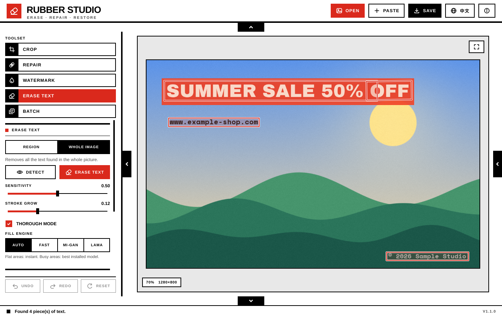
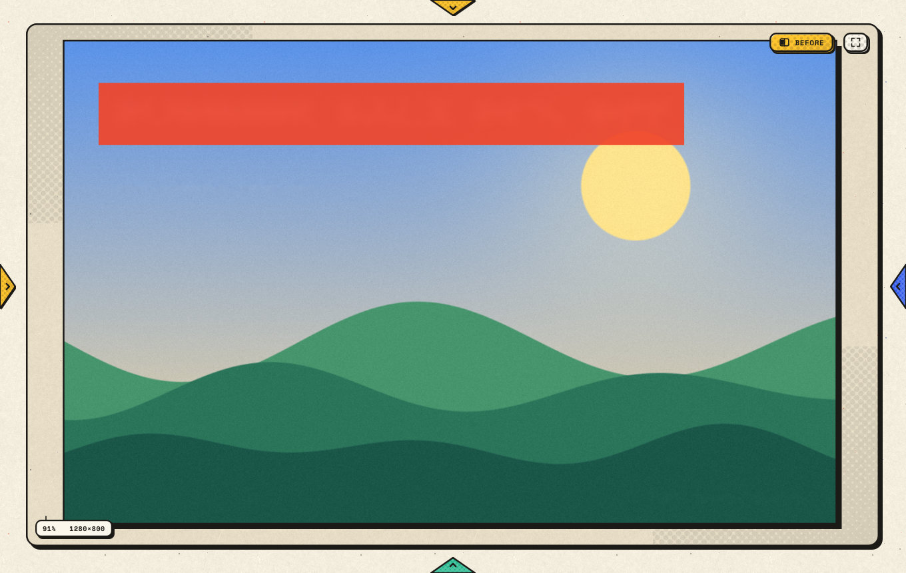

<div align="center">


# RUBBER STUDIO

**擦除 · 修复 · 还原**<br>
批量去除图片里的文字，另有修复、裁剪、加水印 —— 完全离线运行的 Windows 原生程序。

<!--badges-->
[](https://github.com/03319053e-commits/RubberStudio/actions/workflows/build-windows.yml)
[](LICENSE)
<!--/badges-->

[**⬇ 下载 Windows 版**](../../releases/latest) · [English](README.md)


</div>

## 功能

- **批量去除文字** —— 把一堆图片或整个文件夹拖进窗口，点“开始”，每张图都会去掉文字后输出。队列以“胶片”形式显示，
  每一帧都有实时状态；可随时停止、重新运行，也可以把任意一帧打开到编辑器里对比“原图”。
- **真正的去字，而不是模糊** —— 本机文字检测器（PP-OCRv4，支持中文、英文及混排）找到文字，只重绘**笔画本身**，
  文字周围的画面保持不动。纯色/渐变背景（横幅、字幕、说明文字、水印）瞬间填好；复杂的照片背景可使用可选的
  AI 修复模型（LaMa），下载一次之后同样离线使用。
- **默认安全** —— 绝不覆盖原图。结果默认写入每张图片所在文件夹下的 `RubberStudio_clean`（也可自选文件夹），可设置文件名
  后缀、输出格式（原格式 / PNG / JPG / WebP）及质量、是否保留子文件夹结构，以及文件已存在时的处理（改名 / 跳过 / 覆盖）。
  多张图片并行处理；没有文字的图片也可以一并复制过去。
- **一个区域，全部适用** —— 在示例图上框出一块位置（比如角落的水印条），所有图片都只清理同一相对位置。
- **单张图片工具** —— “去除文字”（整张图片或框选区域，带检测预览和“原图”对比开关）、“修复”画笔（修复、涂抹、
  重建颗粒）、“裁剪”，以及可调字体、颜色、大小、不透明度的文字“水印”。
- **隐私** —— 不上传任何内容。唯一的联网行为是可选的 AI 模型下载，并且只在你确认之后才会进行。
- **为 Windows 准备** —— 绿色免安装文件夹（无需管理员权限），全程支持中文/Unicode 路径，适配高分屏，界面有中文和英文。

<div align="center">


</div>

## 下载（Windows 10 / 11，64 位）

1. 打开[**最新发布页**](../../releases/latest)，下载 `RubberStudio-<版本>-windows-x64.zip`。
2. 解压到任意位置（请先完整解压，不要在压缩包预览里直接运行）。
3. 运行 `RubberStudio.exe`。

程序没有代码签名，第一次运行时 Windows SmartScreen 可能提示“Windows 已保护你的电脑”：点**更多信息 → 仍要运行**即可。
每个发布版本都由本仓库公开的 [GitHub Actions 工作流](.github/workflows/build-windows.yml) 构建，并且在发布前会运行
打包后程序的自检。

如果在很新的 Windows 上无法启动，请安装
[Microsoft Visual C++ 运行库（x64）](https://aka.ms/vs/17/release/vc_redist.x64.exe)。

设置、日志和可选的 AI 模型都保存在 `%LOCALAPPDATA%\RubberStudio`；删除该文件夹即可恢复初始状态，删除程序文件夹即为卸载。

## 使用方法

**批量去文字** —— 选择“批量去文字”工具，然后：

1. 添加图片或文件夹（用按钮，或直接拖进窗口：多个文件或文件夹会直接进入队列，单个文件则在编辑器中打开）；
2. 在“输出”卡片里设置输出文件夹、格式和选项；
3. 点“**开始**”。每一帧依次变为“处理中 → 完成”（或“无文字”/“失败”）；点“**停止**”会干净地取消，不会留下写了一半的文件。

| 快捷键 | 作用 |
|---|---|
| `Ctrl+O` / `Ctrl+S` | 打开 / 保存 |
| `Ctrl+C` / `Ctrl+V` | 复制图片 / 粘贴剪贴板中的图片 |
| `Ctrl+Z` / `Ctrl+Y` | 撤销 / 重做 |
| `Ctrl+Enter` / `Esc` | 运行当前工具 / 关闭工具 |
| `0`、滚轮、`空格`+拖动 | 适应窗口、缩放、平移 |
| `F1` | 帮助 |

工具栏像信封一样可以折叠（点边缘的小标签），让图片占满整个窗口。

### AI 填充（可选）

在“去除文字”工具里打开“AI 模型”卡片：点“**下载**”，确认后会从 Hugging Face（或镜像）获取 `lama.onnx`
（约 208 MB，Apache-2.0，[Carve/LaMa-ONNX](https://huggingface.co/Carve/LaMa-ONNX)）；或者点“**导入…**”选择你已有的模型文件。
不安装也完全可用（使用内置的快速填充）。勾选“使用 AI 模型”后，复杂背景会自动用它；勾选“始终使用 AI”则强制使用。

## 从源码运行

Python 3.10 及以上（CI 使用 3.12），Windows / Linux / macOS 均可：

```bash
python -m venv .venv
.venv\Scripts\activate            # Linux/macOS：source .venv/bin/activate
pip install -r requirements.txt
python -m rubberstudio            # 也可以：python -m rubberstudio 图片.png 文件夹/
```

Windows 上双击 `run_windows.bat` 即可完成同样的事。常用参数：`--lang en|zh`、`--no-splash`、
`--selftest report.json`（检查内置模型、引擎、批量处理和界面）、
`--screenshot out.png --tool erase|batch|repair|crop|watermark`（无界面渲染窗口截图）。

## 自己打包 Windows 程序

要么交给 GitHub 来做（推送一个形如 `v1.0.0` 的标签，工作流会构建、测试，并把 zip 附到发布页），要么在装有 Python 3.12 的 Windows 电脑上运行：

```bat
build_windows.bat
```

它会创建虚拟环境、安装依赖并执行 `pyinstaller packaging\RubberStudio.spec`，产物为
`dist\RubberStudio\RubberStudio.exe` 和一个可直接分享的 zip。

测试（引擎与界面，无头运行）：`pip install -r requirements-dev.txt && python -m pytest`。

## 去字原理

1. **检测** —— DBNet 文字检测器（PP-OCRv4，ONNX Runtime，CPU）找出文字行；大图按重叠分块、以原始分辨率处理，
   小字不会因缩放而丢失；紧贴可靠文字的小符号（“©”、项目符号、句点）通过滞后阈值找回；模型完全没反应的符号，
   则直接检查文字行两端旁边的像素来补上（同墨色、字符大小、仅限平坦或平滑渐变的背景）。
2. **只取笔画** —— 在每个文字框内为背景建模（平坦/平滑背景用框边缘拟合的平面，否则用局部中值），
   与背景不同的像素就是笔画蒙版；蒙版会稍作扩展并闭合，避免残留的笔画色点被填充算法“抹开”。
3. **填充** —— 平坦背景用带颗粒匹配的快速修复填充；复杂背景在已安装 LaMa 时交给它处理。

小技巧：文字很淡或有艺术效果时提高“灵敏度”，误检了非文字图形时降低它；字周围的细描边或阴影没去干净时提高“笔画扩展”。

## 设计

界面采用撞色纸张 + 胶片的波普风：扁平油墨色与刻意错位的套色填充、所有色块上的 Ben-Day 网点、硬阴影与按下即陷入阴影的按钮、
纸张颗粒、Archivo Black + Space Mono 字体，以及像信封一样折叠的工具栏。所有颜色、字体和尺寸集中在
[`rubberstudio/theme.py`](rubberstudio/theme.py)。

## 目录结构

```
rubberstudio/
  core/        不依赖 Qt 的引擎：文字检测、笔画蒙版与填充、LaMa 封装、批量运行器、图片读写
  widgets/     画布、工具抽屉页、胶片队列、信封面板、波普控件、矢量图标、对话框
  editor.py    编辑模型（工具、撤销/重做、异步擦除）     mainwindow.py   主窗口、拖放、快捷键
  theme.py     设计规范与样式表                           strings.py      中英文界面文字
assets/        字体（OFL）、图标、界面图片                packaging/      PyInstaller 规格与启动器
tests/         引擎、批量与界面测试                       .github/        Windows 构建工作流
```

## 合理使用

请只处理你拥有或获准编辑的图片。去除他人的水印、署名或授权声明可能侵犯其权利。

## 许可证

[MIT](LICENSE)。第三方组件（检测模型、字体、Qt、OpenCV、ONNX Runtime 等）及其许可证见 [NOTICE.md](NOTICE.md)。
